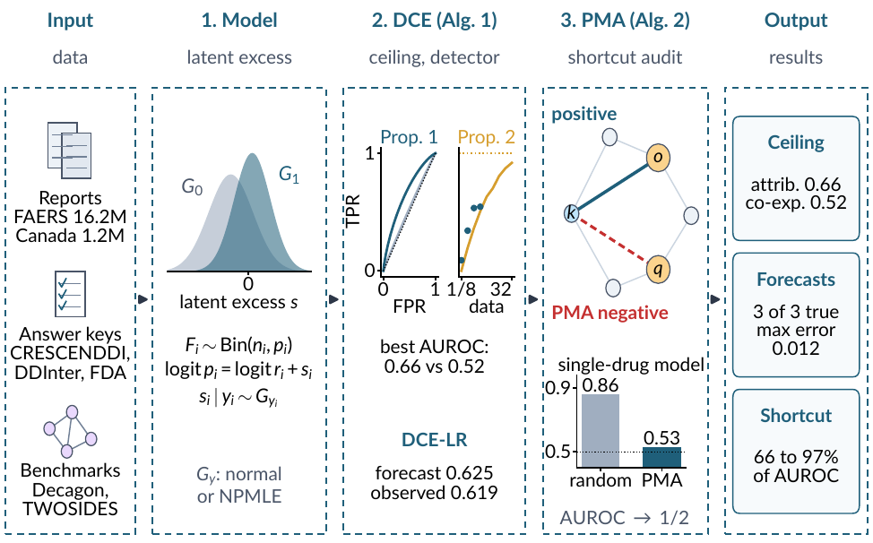

# DDI-Ceiling: Measuring the Interaction Signal in Drug-Drug Interaction Data and Models

Ceilings, forecasts and shortcut audits for drug-drug interaction learning.

## Overview

Drug-drug interaction (DDI) models are trained and evaluated on adverse-event reports, yet how much interaction signal
those reports contain has not been measured. DDI-Ceiling models each report count as its single-drug expectation plus
a latent excess, and uses that one model to measure the signal in a data source and the signal a model has learned.
It estimates the best accuracy any detector can reach on a report channel, forecasts how much accuracy more reports would add, and
audits benchmarks for single-drug shortcuts.

## Key Features

- **Ceiling estimation (DCE)**: the best AUROC any statistic of a report channel can reach against a curated answer
  key, in a normal or nonparametric (NPMLE) form, with drug-cluster bootstrap intervals
- **Forecasting**: the AUROC a channel will reach with more reports, or with reports from another database
- **Optimal detector (DCE-LR)**: the cross-fitted likelihood ratio of the fitted model
- **Shortcut audit (PMA)**: negatives matched on single-drug propensity, so any single-drug shortcut scores exactly at
  chance, with a leakage diagnostic and the shortcut share of a model's AUROC
- **Identifiability-first training**: a negative sampler that mixes matched and random negatives for training and
  model selection
- **Lightweight**: NumPy, SciPy and scikit-learn only; runs on a laptop in minutes

## Example Notebook

For a complete walkthrough, see the [FAERS example notebook](example_notebooks/faers_example.ipynb) which demonstrates
measuring the interaction signal of two FAERS report channels against the CRESCENDDI reference set, forecasting it at
other report volumes, and auditing a DrugBank DDI link-prediction benchmark. Installation, a quick start and the main
components are described in [example_notebooks/README.md](example_notebooks/README.md).

## Citation

If you use this code, please cite: Gromova, A., & Maida, A. S. (2026). **Is the Interaction in the Data? Ceilings,
Forecasts and Shortcut Audits for Drug-Drug Interaction Learning.** Submitted to RECOMB 2027.

## License

MIT License

Copyright (c) 2026 Anastasiya Gromova and Anthony S. Maida

Permission is hereby granted, free of charge, to any person obtaining a copy of this software and associated
documentation files (the "Software"), to deal in the Software without restriction, including without limitation the
rights to use, copy, modify, merge, publish, distribute, sublicense, and/or sell copies of the Software, and to permit
persons to whom the Software is furnished to do so, subject to the following conditions:

The above copyright notice and this permission notice shall be included in all copies or substantial portions of the
Software.

THE SOFTWARE IS PROVIDED "AS IS", WITHOUT WARRANTY OF ANY KIND, EXPRESS OR IMPLIED, INCLUDING BUT NOT LIMITED TO THE
WARRANTIES OF MERCHANTABILITY, FITNESS FOR A PARTICULAR PURPOSE AND NONINFRINGEMENT. IN NO EVENT SHALL THE AUTHORS OR
COPYRIGHT HOLDERS BE LIABLE FOR ANY CLAIM, DAMAGES OR OTHER LIABILITY, WHETHER IN AN ACTION OF CONTRACT, TORT OR
OTHERWISE, ARISING FROM, OUT OF OR IN CONNECTION WITH THE SOFTWARE OR THE USE OR OTHER DEALINGS IN THE SOFTWARE.

## Contact

For questions and issues, please open an issue on GitHub or contact the maintainers.
